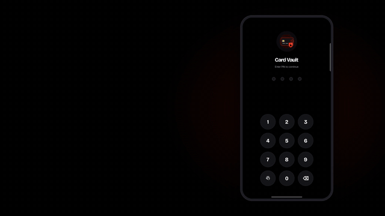

# Card Vault 🔒

Card Vault is a secure, privacy-focused Android application for managing your credit and debit cards, plus a vault for logins, bank account details and secret notes. Built with a "security-first" mindset, it keeps your data on your device, with no account and no cloud sync, and protects it with multiple layers of encryption.

[Watch in full quality (MP4)](docs/animation/brag.mp4)

## ✨ Features

- **Encryption at Rest**: Card numbers, CVVs, and PINs, and the secret fields of every vault entry, are encrypted on your phone.
- **Vault for Logins, Bank Accounts and Notes**: Save logins (with optional 2FA), bank account details and secret notes next to your cards. Search and filter by type.
- **2FA Codes**: Store a login's authenticator secret (type it in or scan its QR code) and see its rotating code inside the app.
- **Open Website or App**: Open a saved login's website or Android app straight from the vault. The password is copied for you and the username is shown.
- **Biometric Security**: Unlock with your fingerprint or face, or your device screen lock, whichever your phone supports.
- **PIN Protection**: Set a custom 4-digit PIN with a "fail-safe" lockout mechanism (30-minute lock after 5 failed attempts).
- **Auto-Lock**: Lock the app after 30 seconds to 5 minutes of inactivity, or turn it off.
- **OCR Card Scanning**: Quickly add new cards by scanning them with your camera (text is read on your phone).
- **Encrypted Backups**: Export your cards and vault entries to an encrypted file. Restore it anytime with your backup password.
- **Google Passwords Import**: Bring in logins from a Google Password Manager CSV export.
- **Smart Sorting & Filtering**: Filter cards by type (Credit, Debit, Prepaid, Corporate) and network (Visa, Mastercard, etc.). Sort by custom order, name, newest or recently used. Switch between a list and a 3D card carousel.
- **Clipboard Safety**: Automatically clears copied card and vault data from your clipboard after a configurable delay.
- **Expiry Alerts**: Get notified before your cards expire so you're never caught off guard.
- **CardVault Pro**: Offline license-key activation unlocks unlimited cards, card scanning, encrypted backups and restore, Google Passwords import and expiry alerts. Everything else is free. See the [Free vs Pro table](docs/USER_GUIDE.md#free-and-pro).
- **CRED-inspired Dark Mode**: A sleek, deep-black interface designed for modern Android devices. A light theme is also available.

## 📥 Install

Needs Android 12 or newer. Allow "install from unknown sources" when installing an APK.

## 🛡 Your privacy

- **Works fully offline.** There are no accounts, no cloud sync, no analytics and no ads.
- **Your data stays on your phone.** Nothing is uploaded, and you control your backups.
- **Camera frames are never saved.**

Read the full [user guide](docs/USER_GUIDE.md) for a screen-by-screen walkthrough.
