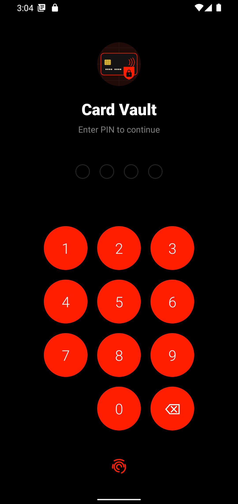
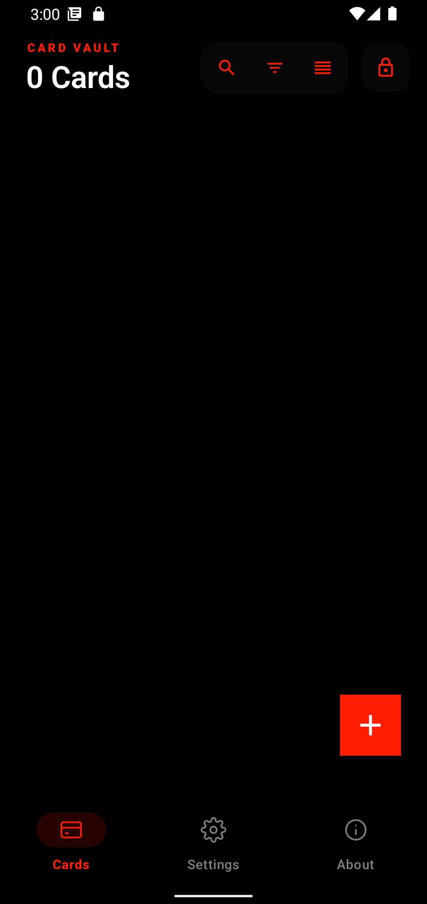
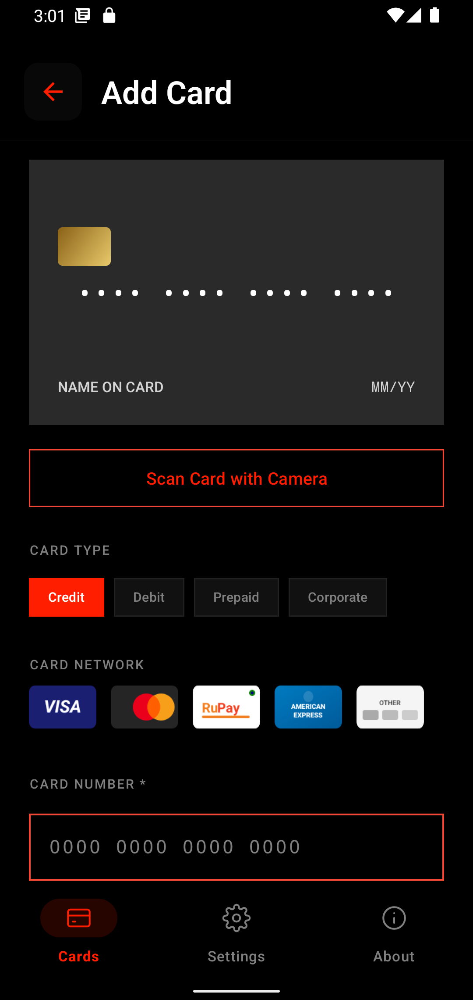
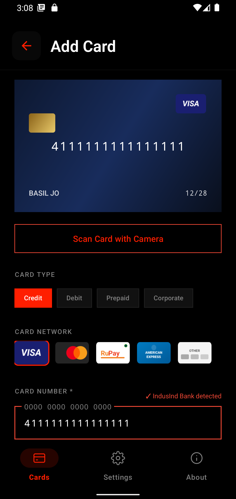
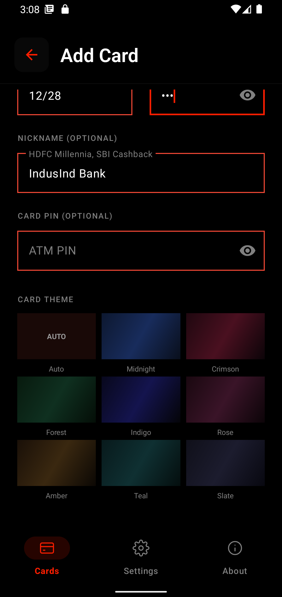

# Card Vault: User Guide

Card Vault is an offline card manager. Your card details are encrypted on your phone and never leave it. The app has no internet permission, no account and no cloud sync. It needs Android 12 (API 31) or higher.

- [First launch](#first-launch)
- [Your cards](#your-cards)
- [Adding a card](#adding-a-card)
- [Viewing a card](#viewing-a-card)
- [Settings](#settings)
- [Free and Pro](#free-and-pro)
- [Privacy and security](#privacy-and-security)

> The screenshots show the dark theme. Light theme is switched on in **Settings → Appearance → Dark Mode**.

---

## First launch

On first launch you create a 4-digit PIN and confirm it. This PIN unlocks the app every time.

| Unlock screen | Empty vault |
|:---:|:---:|
|  |  |

- Tap the fingerprint icon under the keypad to unlock with biometrics instead of the PIN.
- After **5 wrong PINs** the app locks for **30 minutes**.
- The lock icon at the top right of the home screen locks the vault immediately.
- The app can lock itself after a period of inactivity (see [Settings](#settings)).

## Your cards

The home screen lists your cards. The header shows how many you have, and the icons beside it are:

| Icon | What it does |
|---|---|
| Search | Find a card by typing |
| Filter | Narrow by type (Credit, Debit, Prepaid, Corporate) and by network (Visa, Mastercard, RuPay, Amex, Other) |
| Sort | Sort by custom order, name, newest, or recently used |
| Lock | Lock the vault now |

Tap the **+** button to add a card. The bottom bar switches between **Cards**, **Settings** and **About**.

## Adding a card

Tap **+** and fill in the form. The card preview at the top updates as you type.

| Empty form | Filled form |
|:---:|:---:|
|  |  |

1. **Card type**: Credit, Debit, Prepaid or Corporate.
2. **Card network**: Visa, Mastercard, RuPay, American Express or Other. It is picked for you once the number is recognised.
3. **Card number**: required. If the number's prefix matches a known bank, you will see "<bank> detected" beside the label, and the bank name fills the nickname.
4. **Name on card**, **expiry (MM/YY)** and **CVV**: expiry and CVV are required.
5. **Nickname** and **ATM PIN**: both optional.
6. **Card theme**: pick a colour for the card, or leave it on Auto.
7. Tap **Save Card Securely**.

**Scan Card with Camera** reads the number, expiry and name from the physical card using on-device text recognition. It needs [Pro](#free-and-pro). Camera frames are never saved.

Card number, CVV and PIN are stored with AES-256 encryption.

## Viewing a card

Tap a card to open it. From the card screen you can:

- **Tap the card** to flip it and see the back (CVV and card PIN).
- **Copy Card Number**, **Copy Expiry**, **Copy CVV** or **Copy All Details**.
- **Share Card (Safe)** to share the card without exposing its sensitive numbers.
- Edit or delete the card.

Copied data is cleared from the clipboard automatically after the delay you choose in Settings.

## Settings

| Setting | What it does |
|---|---|
| **Lock Screen PIN** | Reset the PIN you unlock the app with. Failed attempts are shown here. |
| **Appearance** | Switch between light and dark theme. Dark is a deep-black theme. |
| **Clipboard Clear Timer** | Clear copied card data after 30s, 1m, 2m, 3m or 5m. |
| **Auto-Lock Timer** | Lock the app after inactivity: Off, 30s, 1m, 2m or 5m. |
| **CardVault Pro** | Shows your plan and lets you activate a licence. |
| **Export Encrypted Backup** | Save all your cards to an AES-256 encrypted file, protected by a password you choose. *(Pro)* |
| **Restore Backup** | Load a backup file and enter its password. *(Pro)* |
| **Expiry Alerts** | Get notified before your cards expire. *(Pro)* |

> **Keep your backup password safe. It cannot be recovered.** Without it, a backup file cannot be opened.

## Free and Pro

|  | Free | Pro |
|---|:---:|:---:|
| Encrypted card storage | ✓ | ✓ |
| PIN and biometric unlock | ✓ | ✓ |
| Search, filter and sort | ✓ | ✓ |
| Light and dark theme | ✓ | ✓ |
| Number of cards | up to 5 | unlimited |
| Card scanning with camera | – | ✓ |
| Encrypted backup and restore | – | ✓ |
| Expiry alerts | – | ✓ |

**Downgrading never hides or deletes anything.** If you have more than 5 cards on the Free plan, you can still view, edit and delete them. You just can't add more.

### Activating Pro

Pro uses an offline licence key. No Google Play, account or internet connection is involved.

1. Open **Settings → CardVault Pro**. You will see a six-character device code.
2. Tap **Copy request** or **Share request** and send the text to the developer.
3. Paste the licence key you receive into **License key** and tap **Activate**.

The section then shows *Pro · Activated on this device*, with the expiry date or "never expires". A licence only works on the device it was issued for.

## Privacy and security

- All data stays on your device. There is no cloud, server or internet access.
- Card number, CVV and PIN are encrypted at rest with AES-256-GCM. The keys are held in the Android Keystore and are bound to your device.
- The camera is used only for scanning, and frames are never saved.
- Backups are encrypted with a password only you know. Because there is no cloud sync, you alone control where backups are kept.
- The **About** tab shows the app version and the full privacy policy.

---

Copyright © 2026 Basil Jose. This project is private and for demonstration purposes.
