# Card Vault: User Guide

Card Vault is an offline manager for your cards, logins, bank account details and secret notes. Your data is encrypted on your phone and is never uploaded. The app has no account, no cloud sync and no ads, and every feature works without an internet connection.

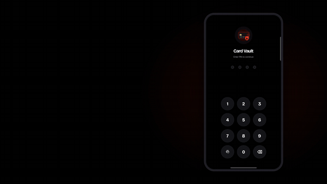

[Watch in full quality (MP4)](animation/brag.mp4)

- [First launch](#first-launch)
- [Your cards](#your-cards)
- [Adding a card](#adding-a-card)
- [Viewing a card](#viewing-a-card)
- [Vault: logins, bank accounts and notes](#vault-logins-bank-accounts-and-notes)
- [Settings](#settings)
- [Free and Pro](#free-and-pro)
- [Privacy and security](#privacy-and-security)

> The screenshots show the dark theme. Light theme is switched on in **Settings → Appearance → Dark Mode**.

---

## First launch

On first launch you create a 4-digit PIN and confirm it. This PIN unlocks the app every time.

| Create PIN | Unlock screen | Empty home |
|:---:|:---:|:---:|
| 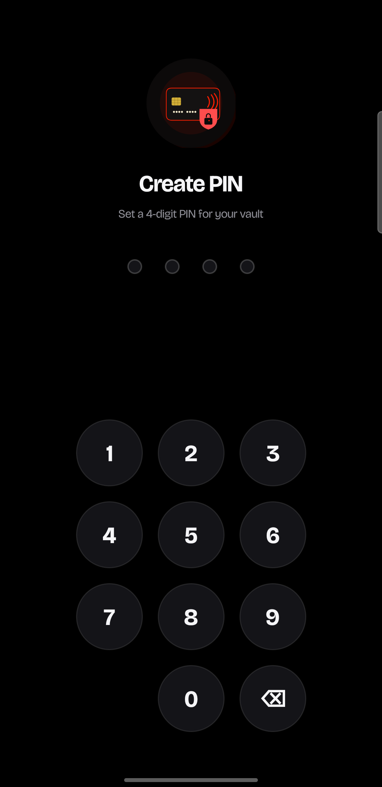 | 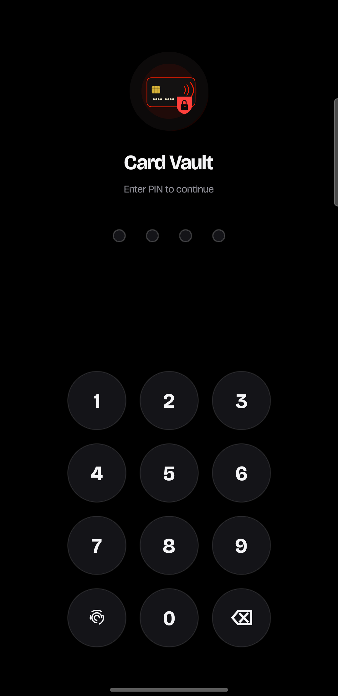 | 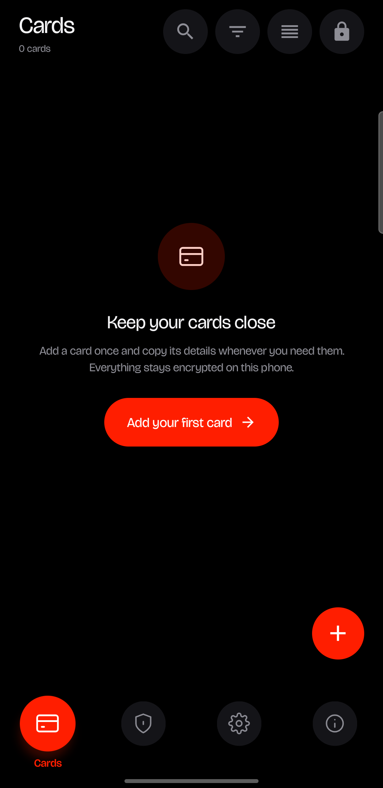 |

- Tap the fingerprint icon under the keypad to unlock with biometrics (or your phone's screen lock) instead of the PIN.
- After **5 wrong PINs** the app locks for **30 minutes**.
- The lock icon at the top right of the home screen locks the vault immediately.
- The app can lock itself after a period of inactivity (see [Settings](#settings)).

## Your cards

The home screen lists your cards. The header shows how many you have, and the icons beside it are:

| Icon | What it does |
|---|---|
| Search | Find a card by typing |
| Filter | Narrow by type (Credit, Debit, Prepaid, Corporate) and by network (Visa, Mastercard, RuPay, Amex, Other) |
| Sort | Sort by custom order, name, newest, or recently used |
| View | Switch between a list and a 3D card carousel (shown once you have a card) |
| Lock | Lock the vault now |

| List | Carousel |
|:---:|:---:|
| 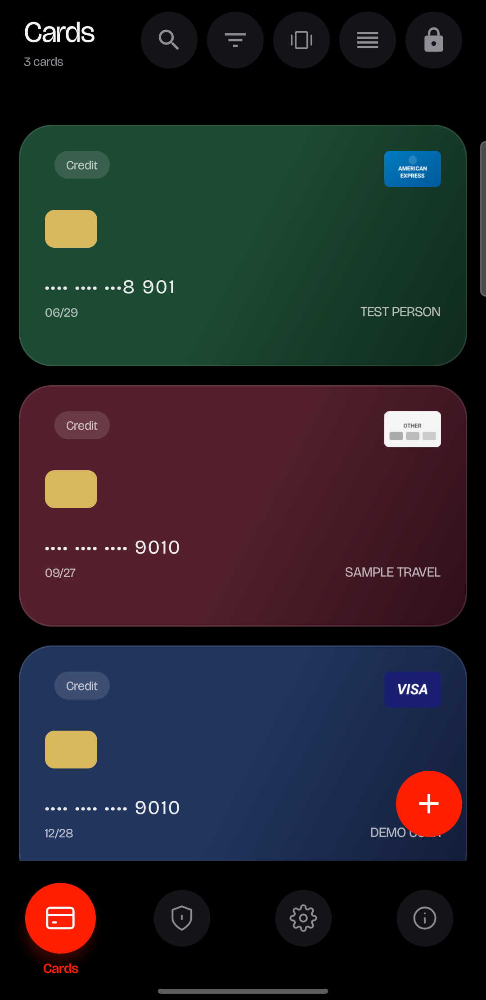 | 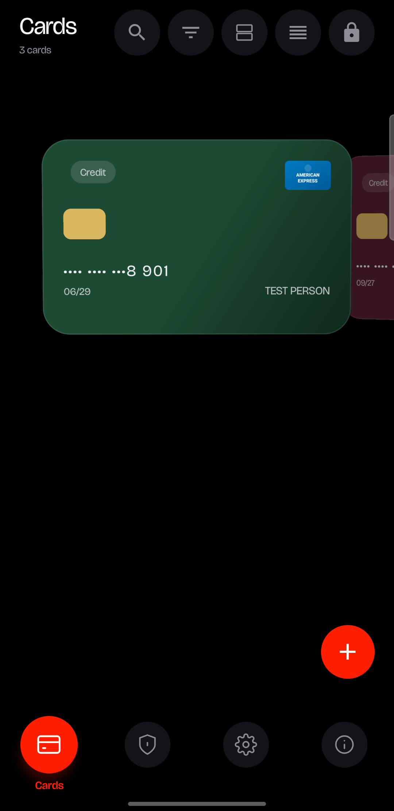 |

In the list, swipe a card left to copy its number, or right to edit it.

Tap the **+** button to add a card. The bottom bar switches between **Cards**, **Vault**, **Settings** and **About**.

## Adding a card

Tap **+** and fill in the form. The card preview at the top updates as you type.

| Empty form | Filled form |
|:---:|:---:|
| 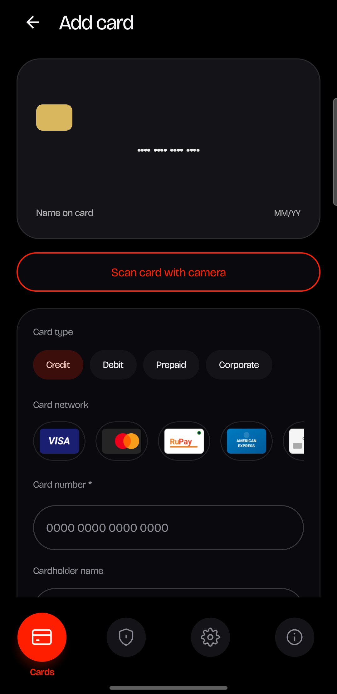 | 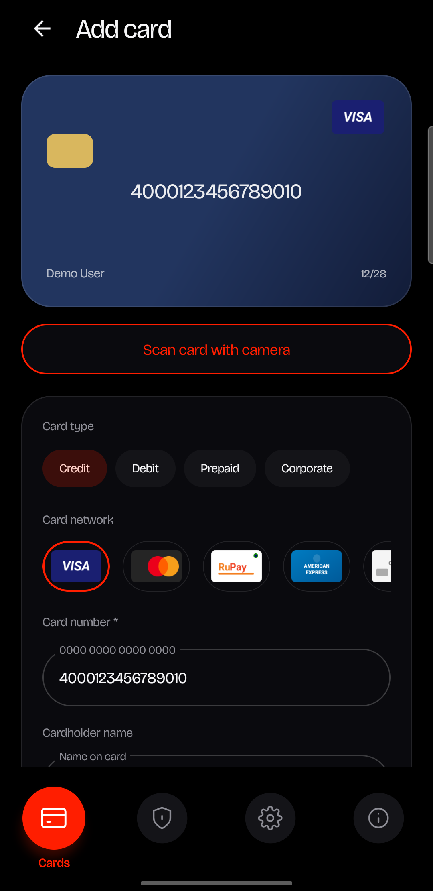 |

1. **Card type**: Credit, Debit, Prepaid or Corporate.
2. **Card network**: Visa, Mastercard, RuPay, American Express or Other. It is picked for you once the number is recognised.
3. **Card number**: required. If the number's prefix matches a known bank, you will see "<bank> detected" beside the label, and the bank name fills the nickname.
4. **Name on card**, **expiry (MM/YY)** and **CVV**: expiry and CVV are required.
5. **Nickname** and **ATM PIN**: both optional.
6. **Card colour**: pick a colour for the card, or leave it on Auto.
7. Tap **Save card securely**.

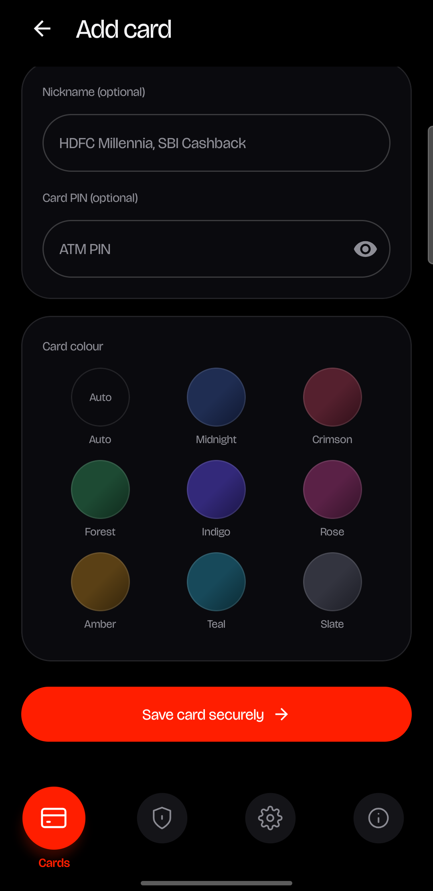

**Scan Card with Camera** reads the number, expiry and name from the physical card using on-device text recognition. It needs [Pro](#free-and-pro). Camera frames are never saved.

Card number, CVV and PIN are stored encrypted on your phone.

## Viewing a card

Tap a card to open it.

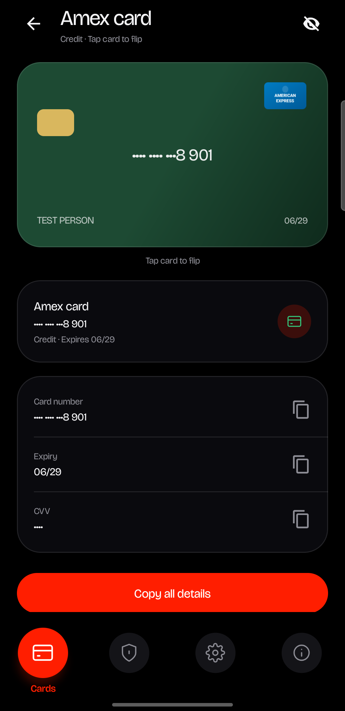

From the card screen you can:

- **Tap the card** to flip it and see the back (CVV and card PIN).
- **Copy Card Number**, **Copy Expiry**, **Copy CVV** or **Copy All Details**.
- **Share Card (Safe)** to share the card without exposing its sensitive numbers.
- Edit or delete the card.

Copied data is cleared from the clipboard automatically after the delay you choose in Settings.

## Vault: logins, bank accounts and notes

The **Vault** tab keeps the rest of your secrets next to your cards. Use the chips at the top to show **All**, **Logins**, **Bank accounts** or **Notes**, and the search icon to find an entry by its title or subtitle.

| Empty vault | Vault list |
|:---:|:---:|
| 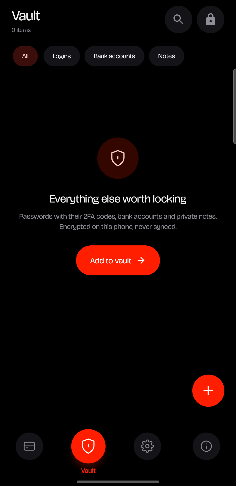 | 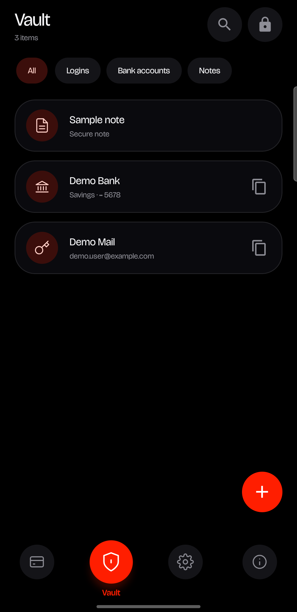 |

Tap **+** and choose what to add:

| Type | What you can save |
|---|---|
| **Login and 2FA code** | Name, username, password, website, 2FA key and notes |
| **Bank account** | Bank name, account holder, account number, account type, IFSC / routing, SWIFT / BIC, IBAN, branch and notes |
| **Secure note** | A title and a private note |

| Add to vault | Add login | Add bank account |
|:---:|:---:|:---:|
| 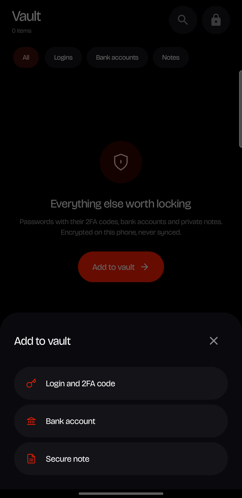 | 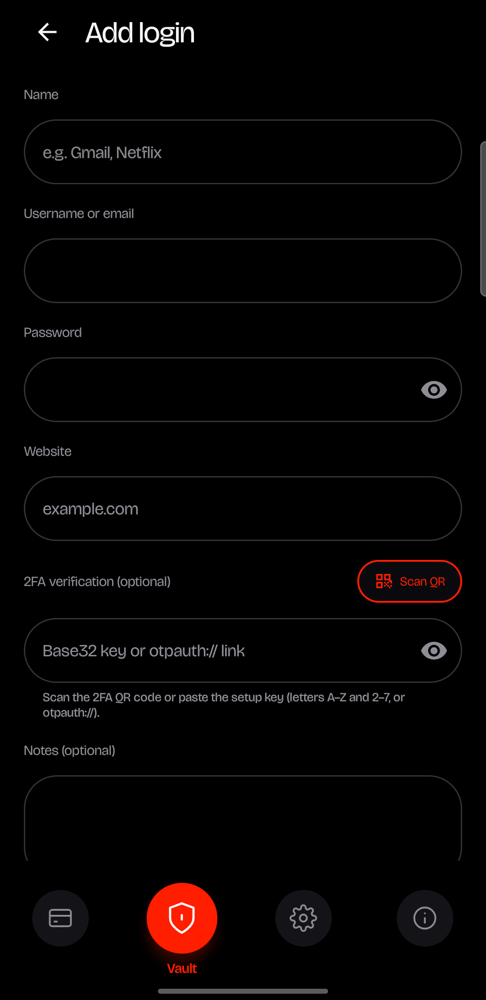 | 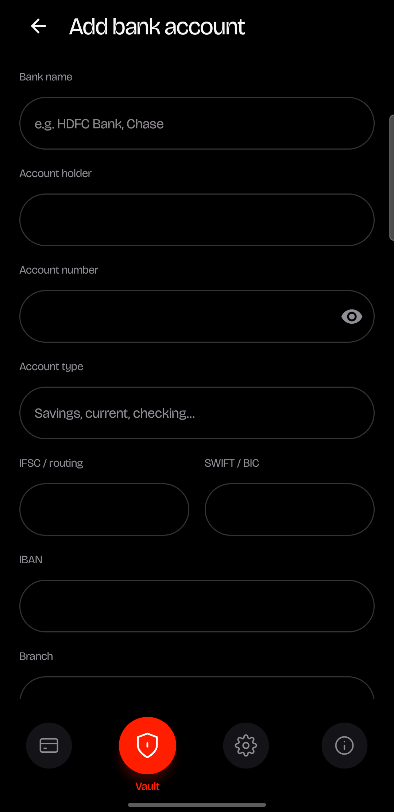 |

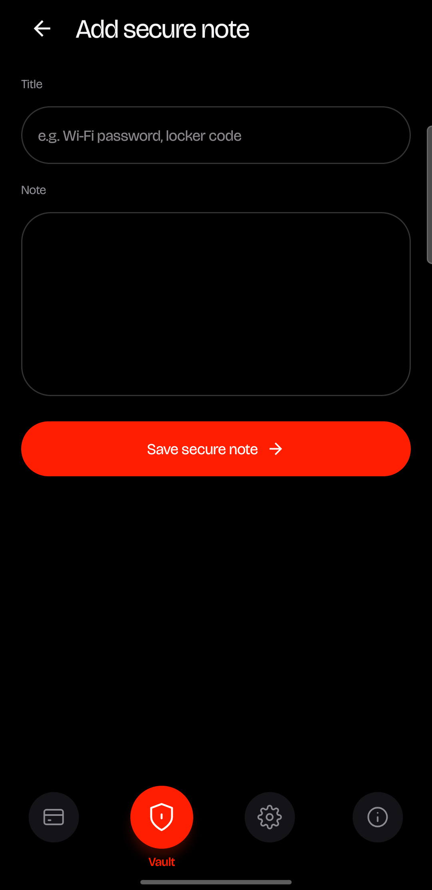

Tap an entry to open it.

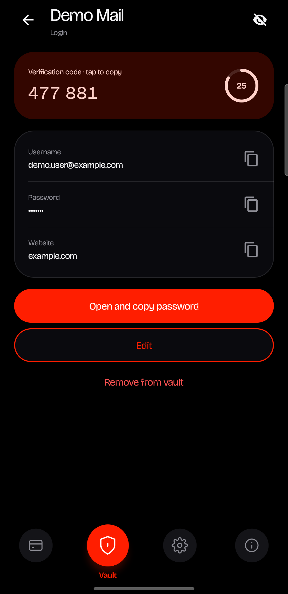

- Secret fields (passwords, account numbers, IBAN) are hidden behind dots. Tap the eye icon to show or hide them.
- Copy a field to the clipboard. It is cleared after the delay you choose in Settings. On Android 13 and later it is also marked as sensitive, so the clipboard preview hides it.
- From the list, the copy button on a login copies its password, and on a bank account its account number.
- **2FA codes:** on a login, paste the setup key (or setup link) into the 2FA field, or scan the QR code with the camera. The entry then shows a code that refreshes with a countdown. Tap it to copy.
- **Open:** on a login with a website, tap **Open and copy password** to go to the site, or to the installed app if the login came from an Android app. Card Vault copies the password and shows the username so you can paste them. It does not fill in forms for you.
- Edit or remove an entry from its screen.

If you use Google Password Manager, you can bring its logins in with [Import from Google Passwords](#settings). Entries that are already in the vault are skipped.

## Settings

| Security and appearance | Backup |
|:---:|:---:|
| 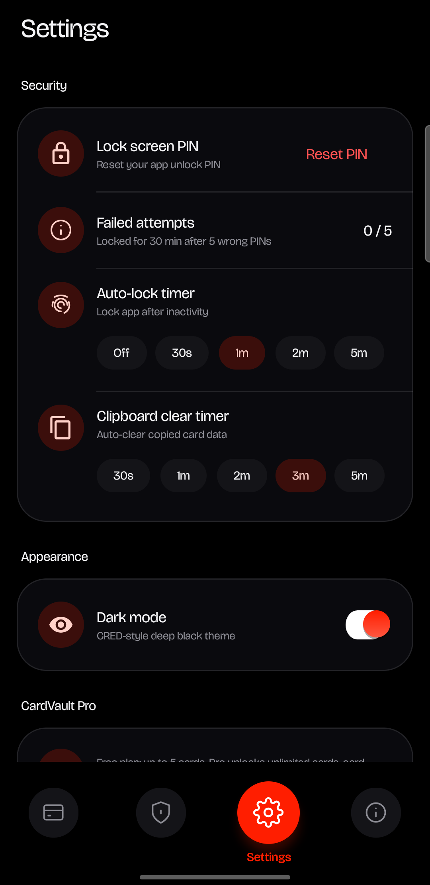 | 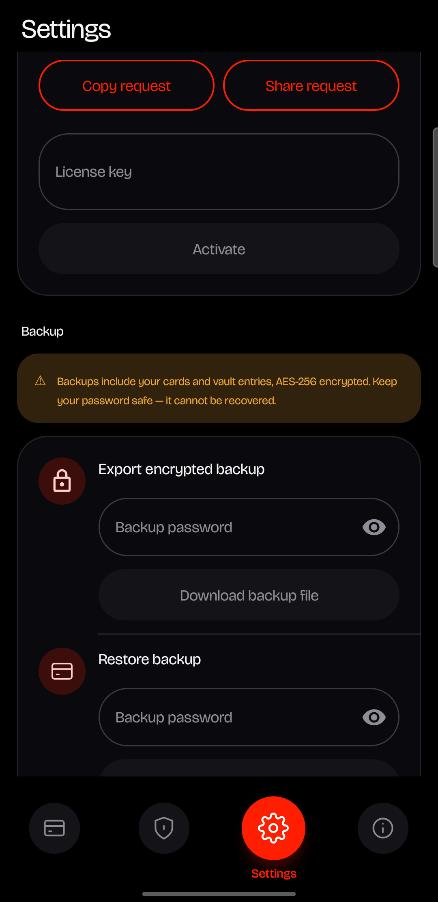 |

| Setting | What it does |
|---|---|
| **Lock Screen PIN** | Reset the PIN you unlock the app with. Failed attempts are shown here. |
| **Appearance** | Switch between light and dark theme. Dark is a deep-black theme. |
| **Clipboard Clear Timer** | Clear copied card and vault data after 30s, 1m, 2m, 3m or 5m. |
| **Auto-Lock Timer** | Lock the app after inactivity: Off, 30s, 1m, 2m or 5m. |
| **CardVault Pro** | Shows your plan and lets you activate a licence. |
| **Export Encrypted Backup** | Save all your cards and vault entries to an encrypted file, protected by a password you choose. *(Pro)* |
| **Restore Backup** | Load a backup file and enter its password. *(Pro)* |
| **Import from Google Passwords** | Pick a CSV exported from Google Password Manager to add its logins to the vault. The CSV is not encrypted, so delete it afterwards. *(Pro)* |
| **Expiry Alerts** | Get notified before your cards expire. *(Pro)* |

> **Keep your backup password safe. It cannot be recovered.** Without it, a backup file cannot be opened.

## Free and Pro

|  | Free | Pro |
|---|:---:|:---:|
| Encrypted card storage | ✓ | ✓ |
| Vault: logins, bank accounts, secret notes | ✓ | ✓ |
| 2FA codes and Open website or app | ✓ | ✓ |
| PIN and biometric unlock, auto-lock | ✓ | ✓ |
| Search, filter and sort | ✓ | ✓ |
| Light and dark theme | ✓ | ✓ |
| Number of cards | up to 5 | unlimited |
| Card scanning with camera | – | ✓ |
| Encrypted backup and restore | – | ✓ |
| Import from Google Passwords | – | ✓ |
| Expiry alerts | – | ✓ |

**Downgrading never hides or deletes anything.** If you have more than 5 cards on the Free plan, you can still view, edit and delete them. You just can't add more.

### Activating Pro

Pro uses an offline licence key. No Google Play, account or internet connection is involved.

1. Open **Settings → CardVault Pro**. You will see a six-character device code.
2. Tap **Copy request** or **Share request** and send the text to the developer.
3. Paste the licence key you receive into **License key** and tap **Activate**.

The section then shows *Pro · Activated on this device*, with the expiry date or "never expires". A licence only works on the device it was issued for.

## Privacy and security

- All data stays on your device. There is no account, cloud sync or ads, and the app never sends your cards or vault entries anywhere.
- Card number, CVV and PIN, and the secret fields of vault entries, are encrypted. Your unlock PIN is never stored in readable form.
- The camera is used only for scanning cards and 2FA QR codes, and frames are never saved.
- Tapping **Open** on a login, or the support links in **About**, hands off to your browser or another app. Card Vault itself does not open those connections.
- Backups are encrypted with a password only you know.
- The **About** tab shows the app version, the developer's contact details, links to report an issue or request a feature, and a list of the app's features.

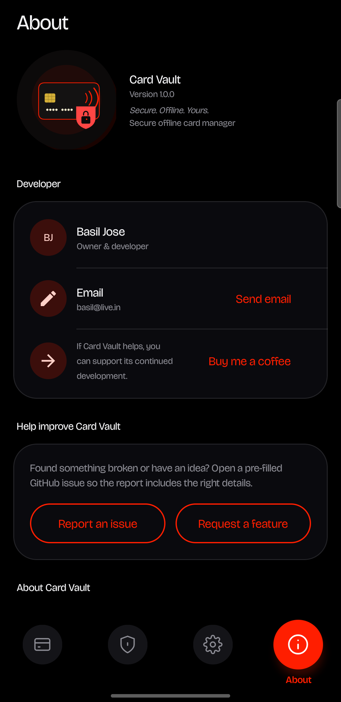
